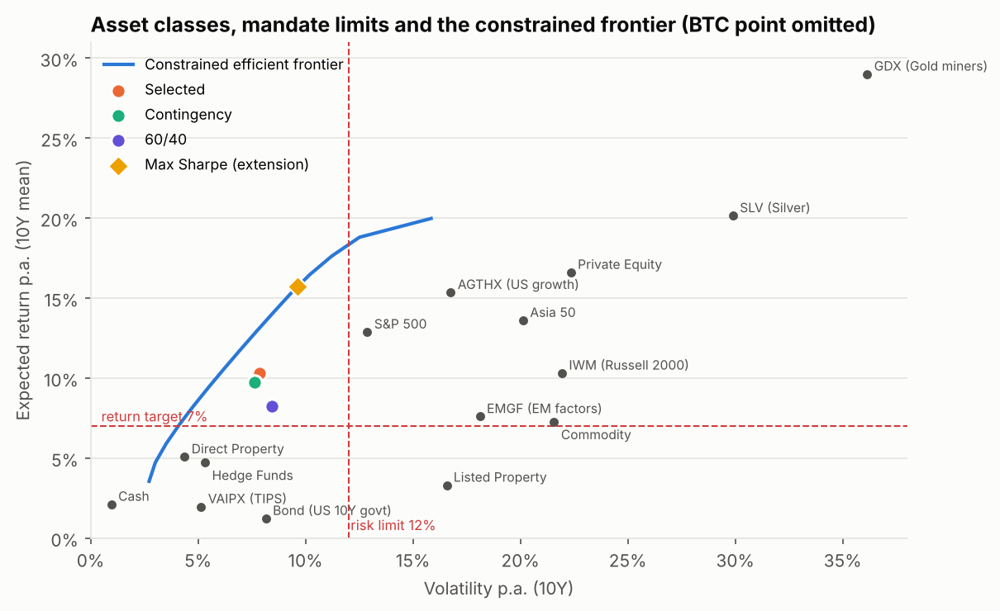
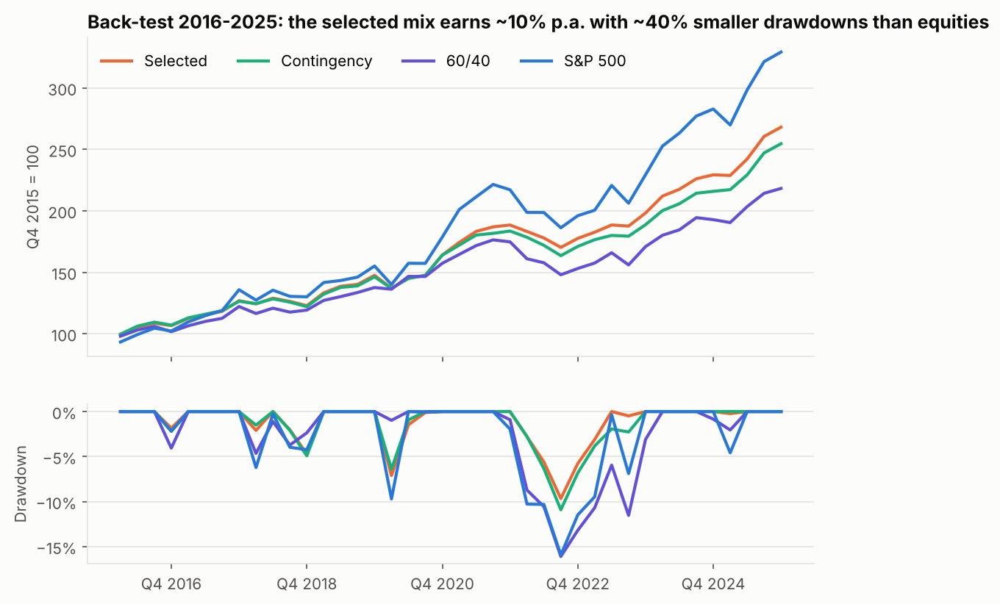
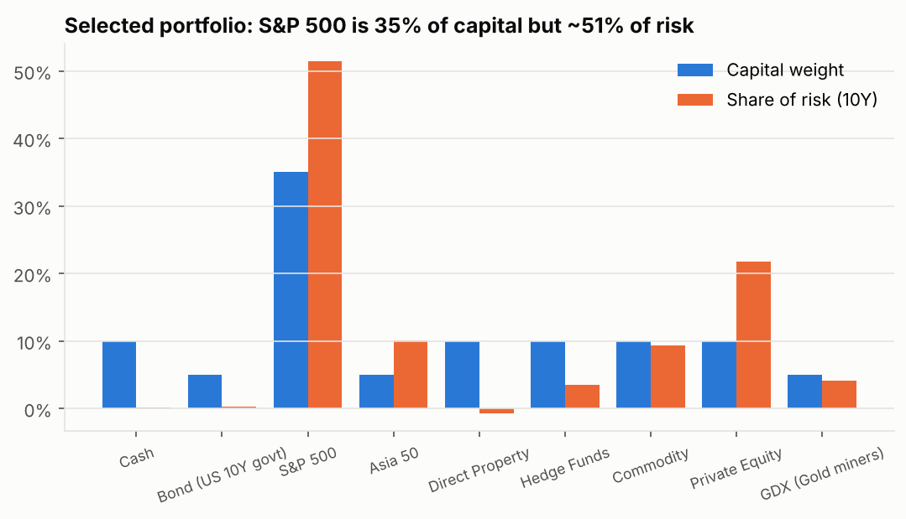
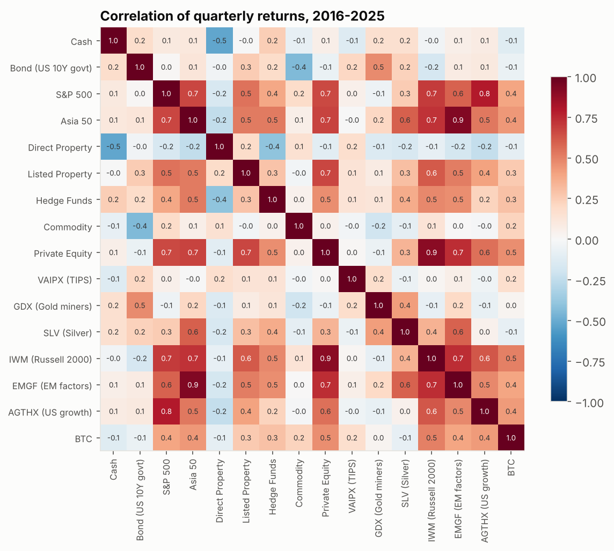

# Multi-Asset Portfolio Construction for an Endowment Fund

**Strategic asset allocation across 16 asset classes, ETFs and crypto under a multi-constraint investment mandate: risk/return analytics, desmoothing of illiquid assets, constrained mean-variance optimisation, back-testing and stress scenarios.**

 

> Developed as coursework during my MSc exchange at RMIT University (Melbourne).
> The original model was an Excel workbook optimised with Solver; this repository rebuilds it as tested Python code
> (every figure is checked against the workbook) and replaces Solver with a reproducible SLSQP optimiser.

**📓 [Read the full analysis with code and outputs → `notebooks/walkthrough.ipynb`](notebooks/walkthrough.ipynb)** — GitHub renders it directly in the browser: every table and chart, no installation needed.

---

## The mandate

A university endowment asks for a long-only strategic allocation that meets:

| Objective / constraint | Limit |
|---|---|
| Expected return (nominal) | ≥ 7% p.a. on **both** 5Y and 10Y estimates |
| Volatility | ≤ 12% p.a. on both windows (and after desmoothing) |
| Cash / liquid assets / traditional assets | ≥ 8% / ≥ 50% / ≥ 50% |
| Alternatives | at least 3 classes, each ≥ 5% |
| Internal risk limits | quarterly CVaR 95% ≥ −10%, inflation beta ≥ −1 |

**Universe (quarterly, 2006 – Q1 2026):** cash, US 10Y Treasuries, S&P 500, S&P Asia 50, direct property (NCREIF), listed REITs,
hedge funds (HFRI FoF), commodities (S&P GSCI TR), listed private equity, six ETFs/funds (TIPS, gold miners, silver, Russell 2000,
EM factors, US growth) and Bitcoin.

## What the code does

1. **Data engineering** – rolls T-bills into a cash total-return index and **rebuilds a 10Y Treasury total-return series from yields** (carry − duration·Δy + ½·convexity·Δy²), replacing a vendor index with three implausible quarters.
2. **Asset analytics** (5Y and 10Y windows) – arithmetic & geometric returns, volatility, Sharpe, downside deviation, historical VaR/CVaR, max drawdown, skew/kurtosis, **inflation beta**, AR(1).
3. **Geltner desmoothing** of appraisal-based property and hedge-fund returns (φ ≈ 0.58 and 0.44) → their true volatility is ~2× the reported one.
4. **Portfolio construction** – covariance matrices, mandate compliance report, Euler **risk contributions**.
5. **Constrained efficient frontier and max-Sharpe portfolio** with `scipy.optimize` (bounds, cash/liquidity/traditional constraints).
6. **Back-test** 2016–2025 (quarterly rebalancing) vs a 60/40 benchmark and the S&P 500, plus **historical stress episodes** used as analogues for 2027 risks (AI-bubble burst, stagflation, Fed shock, oil shock, tariffs).

## Key results

| Portfolio | E[R] 10Y | Vol 10Y | Sharpe 10Y | Max DD | CVaR 95% (q) | Inflation β | 2022 shock |
|---|---|---|---|---|---|---|---|
| **Selected** | **10.3%** | **7.9%** | **1.04** | **−9.7%** | −5.7% | **−0.32** | **−5.8%** |
| Contingency (plan B) | 9.7% | 7.6% | 1.00 | −10.9% | −5.6% | −0.50 | −6.8% |
| 60/40 benchmark | 8.2% | 8.4% | 0.73 | −16.1% | −7.0% | −1.81 | −12.4% |
| S&P 500 | 12.9% | 12.9% | 0.84 | −15.9% | −9.1% | −1.31 | −9.7% |

**Selected allocation:** Cash 10 · Bonds 5 · S&P 500 35 · Asia 50 5 · Direct property 10 · Hedge funds 10 · Commodities 10 · Private equity 10 · Gold miners (GDX) 5 (%).
It passes all 14 mandate rules on both windows (desmoothed volatility 8.2%).

<p align="center">
  
  
  
  
</p>

**Insights**
- Commodities are the **only strong inflation hedge** (inflation beta +8.9) and direct property the best diversifier (negative correlation with equities) — together they lift the portfolio's inflation beta from −1.8 (60/40) to −0.3.
- The S&P 500 is 35% of capital but **~51% of risk**: diversification by capital is not diversification by risk.
- An unconstrained-by-judgement **max-Sharpe optimiser** (extension) piles into gold miners, silver and Bitcoin at their caps (Sharpe 1.42 in-sample): a clear case of *estimation-error maximisation*, which is why the final allocation combines the optimiser with qualitative due diligence.

## Repository structure

```
├── run_analysis.py                  # reproduces every table and chart
├── src/portfolio_construction/
│   ├── data.py                      # universe, TR indices from yields, returns, Geltner desmoothing
│   ├── stats.py                     # asset & portfolio statistics, drawdowns, risk contributions
│   ├── optimize.py                  # mandate, compliance report, SLSQP frontier / max-Sharpe
│   ├── backtest.py                  # fixed-weight back-test, performance metrics, stress episodes
│   └── plotting.py
├── notebooks/walkthrough.ipynb      # narrative walkthrough with outputs
├── tests/test_against_excel.py      # Python == original Excel model
├── data/quarterly_levels.csv
└── outputs/                         # CSV tables + figures
```

## How to run

```bash
git clone https://github.com/mattiamari02-ops/multi-asset-portfolio-construction.git
cd multi-asset-portfolio-construction
pip install -r requirements.txt
python run_analysis.py
pytest -q
```

## Limitations

Historical means are noisy estimates of expected returns (10 years of quarterly data = 40 observations); S&P 500 and ETF series are price indices (no dividends);
listed PE is a proxy for private equity; Q1 2026 is out of sample and DP/HF were not yet reported (weights rescaled). Natural extensions: Black-Litterman views, shrinkage covariance (Ledoit-Wolf), resampled frontiers.

## Data

Quarterly index levels from **LSEG / Refinitiv** (project dataset), US Treasury yields and CPI from LSEG, crypto prices from public sources.
Data are included only to make the results reproducible for educational purposes.

## Author

**Mattia Mari** — MSc Applied Data Science for Banking & Finance, Università Cattolica (exchange at RMIT University, Melbourne).
[LinkedIn](https://www.linkedin.com/in/mattia-mari02) · mattiamari02@gmail.com
